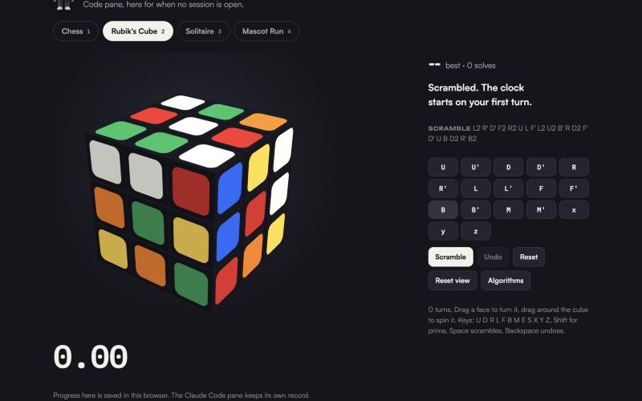
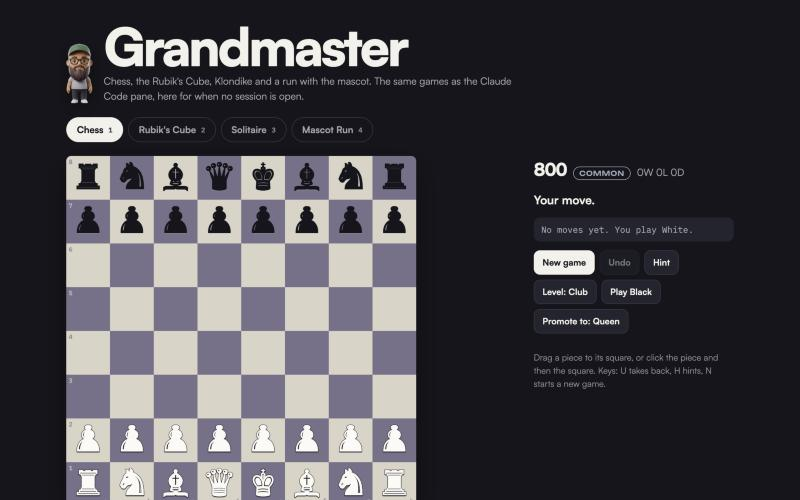
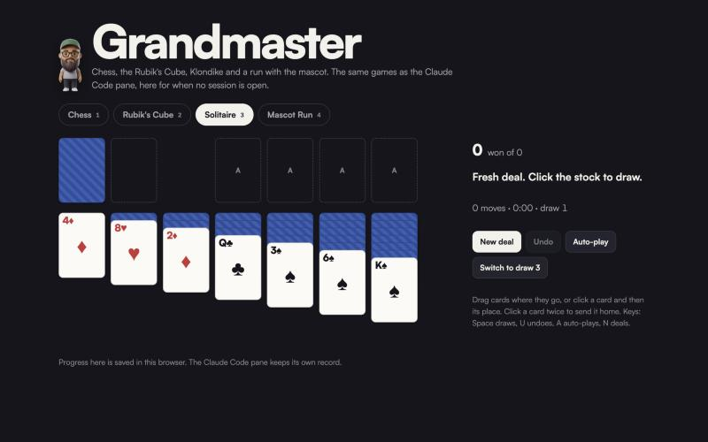
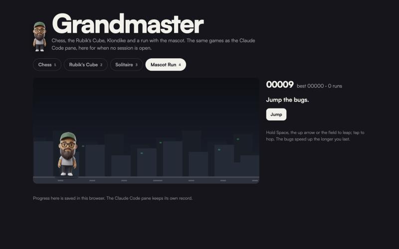

# Grandmaster

Chess, a 3D Rubik's Cube, Klondike and Mascot Run, for the minutes while Claude Code works.

**Play now in your browser: https://ibrahimshareef96-sys.github.io/grandmaster/**

| | |
| --- | --- |
|  |  |
|  |  |

- **Rubik's Cube in 3D:** drag across a face to turn that layer, drag around it to spin it (it keeps your throw), every turn animated. Timed solves, best time, average of five, an algorithm shelf to drill.
- **Chess:** drag and drop or click-click, the engine's replies slide in, three levels, a rating that moves with every game.
- **Klondike:** drag and drop (a run comes with the card you grab), legal drops light up, every card glides into place.
- **Mascot Run:** the 3D Shareefico figure runs, leaps the bugs, squashes as he lands and trips forward when one gets him. Hold to leap, tap to hop.

Progress is saved in your browser's local storage, nowhere else. The page loads fonts from Google Fonts and Fontshare and three.js from cdnjs, so your browser contacts those hosts.

## In Claude Code

**In the Claude desktop app**, install the mod and the 3D page above opens in the app's own browser pane at every session start, beside the chat, on the game you played last. `/chess`, `/cube`, `/solitaire` and `/mascot-run` open it on that game; `/games` brings it back if you closed it. Nothing opens in your system browser. The page keeps your progress in the browser pane's storage, which carries over from one session to the next.

A Claude Code pane cannot host a web page (it draws text cells, pictures with no script, and shaders behind the chat), which is why the 3D games open in the browser pane rather than in a pane of the mod's own.

**In a terminal**, and in the desktop app if its browser pane is turned off, a pane of text-cell boards opens beside the chat instead. Its top line, **▶ Play the 3D version**, opens the page in your browser on the game you are looking at. In the desktop app `/games-text` opens this pane too. Its boards keep their own record across sessions:

| Game | In the pane |
| --- | --- |
| Chess | Play against a built-in engine at three levels (Easy, Club, Strong). Full rules: castling, en passant, promotion, checkmate, stalemate, the fifty-move rule, threefold repetition, insufficient material. Hints, take-backs, play either colour. A rating moves with each finished game (Elo, K = 32). |
| Rubik's Cube | An unfolded 3x3 net you turn with buttons or keys (U D R L F B M, x y z; Shift for prime). Scramble starts a timed solve; the clock runs from your first turn and stops when the cube is solved. Best time and average of five are kept. An algorithm shelf (Sune, T perm, Ua perm and more) applies each one so you can drill it. |
| Solitaire | Klondike, draw 1 or draw 3. Click a card, then where it goes; click it twice to send it to a foundation. Undo, auto-play, and the last cards play themselves once everything is face up. |
| Mascot Run | An endless runner starring the Shareefico pixel mascot. Space, the up arrow or a click jumps the bugs; they speed up the longer you last. Runs and best score are kept. |

## Install

At the prompt of a Claude Code terminal session:

```
/plugin install grandmaster --marketplace ibrahimshareef96-sys/grandmaster
```

Answer `y` to add the marketplace, then press Enter for the user scope. The games open in that session and in every session after.

From a shell:

```bash
claude plugin install grandmaster --marketplace ibrahimshareef96-sys/grandmaster
```

In the Claude desktop app, where `/plugin` does not run: click + next to the prompt box, then Plugins, Add marketplace with `ibrahimshareef96-sys/grandmaster`, then Add plugin.

## Use

- The games open by themselves when a session starts: the 3D page in the desktop app's browser pane, else the text-cell pane. A reload of the mod does not open them again.
- `/games` reopens them. `/chess`, `/cube`, `/solitaire` and `/mascot-run` open them on that game. Each opens the page in place of the tab it opened before, so you never collect copies.
- `/games-text` opens the text-cell pane.
- Keys 1 to 4 switch games, in the page and in the pane.
- Games in progress are saved between sessions, by the page and by the pane each.

The text-cell boards draw in the Claude desktop app and in a terminal. In VS Code and the mobile app the pane shows your record and the link only: neither has a browser pane or an element that runs a web page.

## The 3D page

The page lives in `web/` and is built from the same rule engines as the pane. GitHub Pages serves `docs/index.html`, which `bun web/build.ts --public` writes (needs [Bun](https://bun.sh)); it links the Satoshi font from [Fontshare](https://www.fontshare.com/fonts/satoshi) rather than carrying the file. `bun web/build.ts` without the flag writes `web/dist/grandmaster.html`, one self-contained file with Satoshi inlined when `~/Library/Fonts/Satoshi-Variable.ttf` is installed, for hosts that allow scripts and styles from only a few CDNs.

To open your own copy instead, in the browser pane and from the pane's ▶ link, set the `webPage` option when you install:

```bash
claude plugin install grandmaster --marketplace ibrahimshareef96-sys/grandmaster --config webPage=https://your.site/grandmaster.html
```

The link must start with `https://` or `http://`; anything else falls back to the page above. Change it later with `claude plugin configure grandmaster`.

## License

The code is MIT. The Shareefico mascot artwork (`web/assets/`, the sprite in `hooks/mascot.ts`) is not: see [LICENSE](LICENSE).

## Layout

- `hooks/register.tsx`: commands, what opens at session start, the pane, saving progress.
- `hooks/browser-pane.ts`: opening the 3D page in the desktop app's browser pane (its `Claude_Browser` tools).
- `hooks/*-engine.ts`: the rules of each game, pure functions.
- `hooks/chess-ai.ts`: the chess engine (alpha-beta search with a capture search, thinking one depth per frame).
- `hooks/mascot.ts`: the mascot sprite, copied unchanged from the video mascot.
- `hooks/*-client.tsx`: the four boards.
- `docs/index.html`: the built 3D page GitHub Pages serves (`bun web/build.ts --public`).
- `web/`: the 3D page's source (`entry.ts` bundles the engines, `src/*.js` one file per game, `page.html` the styles, `build.ts` inlines everything; three.js r128 loads from cdnjs with an integrity hash).
- `tests/`: rules (including published perft counts for chess), cube turn directions, solitaire rules, a runner auto-player that proves every bug can be cleared, the pane, and what opens where (browser pane, fallbacks, one tab at a time).

Run the checks with `claude plugin validate .` and `claude plugin test .`.
